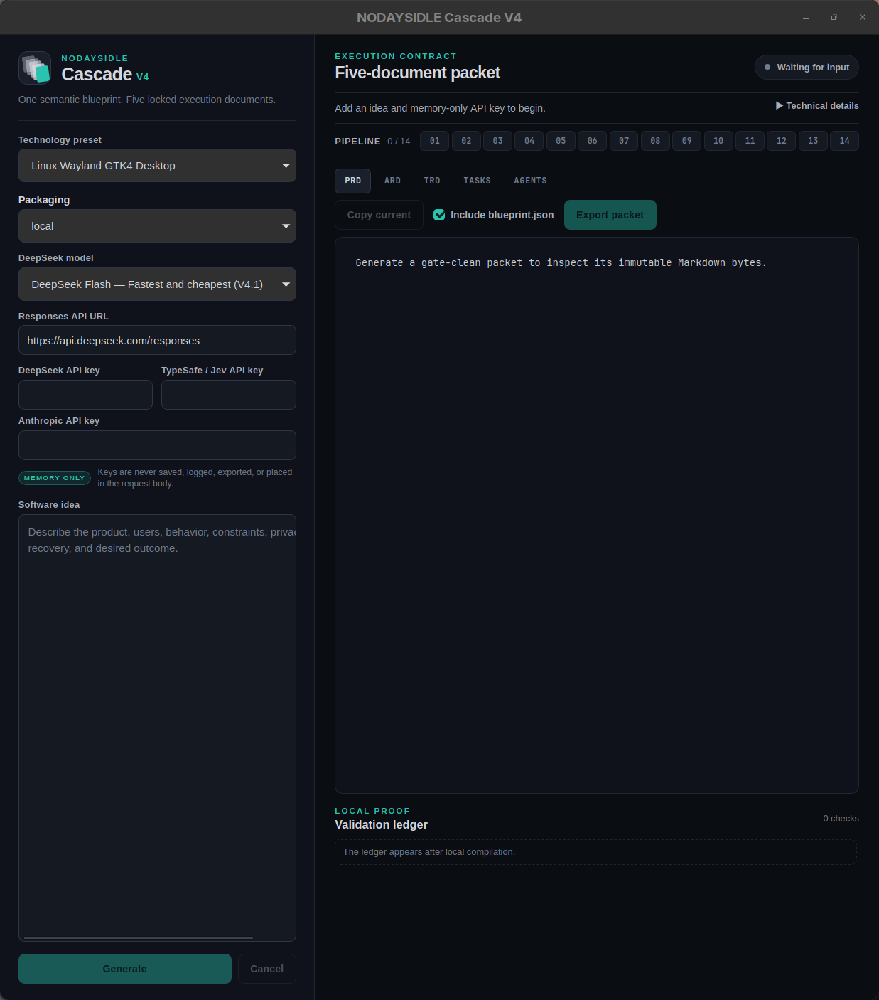
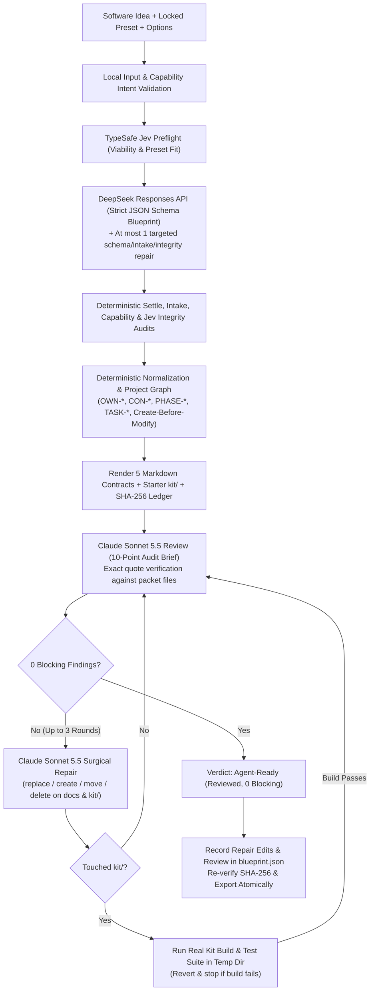

<p align="center">
  
</p>

<h1 align="center">NODAYSIDLE Cascade V4</h1>



<p align="center">
  <strong>Turn one software idea and one locked preset into five agent-ready Markdown contracts, a compiled starter kit, and a reproducible blueprint.</strong><br>
  Local-first compiler + Claude Sonnet 5.5 review, repair, and kit-build verification loop. It actually works.
</p>

<p align="center">
  
  
  
  
  
  
  
  
  
</p>

<p align="center">
  <a href="https://github.com/nodaysidle/nodaysidle-cascade-v4/releases/download/v4.0.0/nodaysidle-cascade-v4-4.0.0-1-x86_64.pkg.tar.zst"><strong>Download Arch Package (4.7 MiB)</strong></a>
  ·
  <a href="https://github.com/nodaysidle/nodaysidle-cascade-v4/releases/download/v4.0.0/nodaysidle-cascade-v4-4.0.0-linux-x86_64.tar.gz"><strong>Download Linux Tarball (5.2 MiB)</strong></a>
  ·
  <a href="https://github.com/nodaysidle/nodaysidle-cascade-v4/releases/download/v4.0.0/nodaysidle-cascade-v4_4.0.0_amd64.deb"><strong>Download Debian/Ubuntu .deb (5.3 MiB)</strong></a>
  ·
  <a href="https://github.com/nodaysidle/nodaysidle-cascade-v4/releases">All Releases</a>
</p>

<p align="center">
  <a href="#what-it-is">What it is</a> ·
  <a href="#evolution-from-cascade-v3--early-v4">Evolution</a> ·
  <a href="#verified-proof-that-it-actually-works">Verified Proof</a> ·
  <a href="#pipeline">Pipeline</a> ·
  <a href="#locked-presets--starter-kits">Presets</a> ·
  <a href="#packet-output">Output</a> ·
  <a href="#install-linux">Install</a> ·
  <a href="#usage">Usage</a> ·
  <a href="#architecture">Architecture</a>
</p>

---

## What it is

**NODAYSIDLE Cascade V4** is a local-first software contract compiler and Tauri 2 desktop application built for Arch Linux / Omarchy (Wayland + Hyprland).

You write one plain-text software idea and pick one locked technology preset. Cascade compiles it into:
1. **Five canonical Markdown contracts** (`PRD.md`, `ARD.md`, `TRD.md`, `TASKS.md`, `AGENTS.md`) with exact `FEAT-*`, `REQ-*`, `ACC-*`, `OWN-*`, `CON-*`, `PHASE-*`, and `TASK-*` traceability and strict create-before-modify file ownership.
2. **A real, buildable starter `kit/`** tailored to the declared data objects, routes, system sources, permissions, and schedules of your idea.
3. **`blueprint.json`** containing the semantic blueprint, preset options, capabilities, SHA-256 hashes of every document and kit file, the validation ledger, and the deterministic repair record so any exported packet can be re-verified and rebuilt byte-for-byte offline.

Open your coding agent (Claude Code, Codex, Cursor) in the exported folder, hand it `PROMPT.md`, and it executes `TASKS.md` phase by phase without guessing stack choices, file paths, or screen layouts.

---

## Evolution from Cascade V3 & Early V4

Cascade V4 is the direct evolution of [`nodaysidle-cascade-v3`](https://github.com/nodaysidle/nodaysidle-cascade-v3) and the initial deterministic-only V4 compiler:

1. **Linux / Wayland / Hyprland & Android Native Focus:** Drops the legacy macOS-only SwiftUI presets and targets **Arch Linux / Omarchy / Wayland** (`linux-wayland-gtk4-desktop`, `linux-hyprland-waybar-module`, `tauri2-rust-typescript-desktop`), **Astro Web** (`astro-web`), and **Android Kotlin Compose** (`android-kotlin-compose` with Navigation 3, Room, edge-to-edge, predictive back).
2. **Real Starter Kits for Every Preset:** Every preset now ships a complete, tested starter `kit/` alongside the five contracts.
3. **Why Early V4 Needed an Evolution:** In a 19-packet live audit of the purely template-driven V4 compiler, only **3 of 19** packets were truly agent-ready on the first pass. Template heuristics alone guessed screen shapes when an idea deviated from a standard list+add form, provider prose occasionally contradicted deterministic contract rules, and starter kits could be narrower than a specific idea's requirements.
4. **The V4 Review → Repair → Build → Re-Review Loop:** Instead of endless per-shape regex patching, V4 keeps the rock-solid deterministic compiler skeleton and adds an automated **Claude Sonnet 5.5 (`claude-sonnet-5-5`) review, surgical repair, and kit-build verification loop** right after compilation:
   - The reviewer audits all 5 rendered documents and every text file in `kit/` against a 10-point agent-readiness brief, requiring exact verbatim file quotes (hallucinated quotes are dropped deterministically).
   - If blocking defects exist, the repair step issues exact file operations (`replace`, `create`, `move`, `delete`) across the documents and `kit/`.
   - Whenever `kit/` is touched, Cascade runs the kit's real build and test suite in an isolated temp directory (`cargo test`/`clippy`, `npm run build`/`test`, `./scripts/gradle.sh testDebugUnitTest`). Any repair that breaks the kit build is discarded.
   - All applied edits are recorded in `blueprint.json` (`manifest.repair`), so `cascade verify --packet` and offline recompilation reproduce the repaired packet byte-for-byte for free.

---

## Verified Proof That It Actually Works

Every claim in this repository is backed by live end-to-end builds, starter-kit compilation, and independent 10-point agent-readiness audits (`scripts/agent-ready/audit-brief.md`):

### 1. Live Desktop UI Verification Across All 5 Presets (5 / 5 Agent-Ready)

Five brand-new product ideas (one per preset, never seen during development) were typed into the installed Linux desktop app (`~/.local/bin/nodaysidle-cascade-v4`), generated, exported, verified with `cascade verify --packet`, built with `scripts/agent-ready/build-round-kits.sh`, and audited file-by-file:

| Exported Packet | Preset | UI Review / Repair Loop | `verify --packet` | Kit Build & Tests | Independent Audit |
| --- | --- | --- | --- | --- | --- |
| **Tea Cellar** (`tea-cellar`) | `linux-wayland-gtk4-desktop` | 2 rounds, 7 edits → `0 blocking` | Verified | `cargo fmt`, `clippy -D warnings`, `cargo test` → `0` | **Agent-ready** |
| **Swap Meter** (`swap-meter`) | `linux-hyprland-waybar-module` | 1 round, 4 edits → `0 blocking` | Verified | `cargo fmt`, `clippy -D warnings`, `cargo test` → `0` | **Agent-ready** |
| **Snippet Vault** (`snippet-vault`) | `tauri2-rust-typescript-desktop` | 1 round, 4 edits → `0 blocking` | Verified | `tsc`, `vitest`, `cargo fmt`, `clippy`, `cargo test` → `0` | **Agent-ready** |
| **Cinema Club** (`cinema-club`) | `astro-web` | 0 rounds, 0 edits → `0 blocking` | Verified | `astro check`, `vitest`, `astro build`, `a11y`, `perf` → `0` | **Agent-ready** |
| **Fuel Log** (`fuel-log`) | `android-kotlin-compose` | 3 rounds, 9 edits → `0 blocking` | Verified | `testDebugUnitTest`, `lintDebug`, `assembleDebug` → `0` | **Agent-ready** |

### 2. Benchmark on the 16 Previously Broken Round-12 Packets (16 / 16 Rescued)

Running the V4 compiler + 3-round Sonnet 5.5 review/repair/kit-build loop across all **16** packets that failed the original round-12 audit:
- **14 / 16 (87.5%)** reached `0 blocking` with a passing kit build within **2 rounds**.
- **16 / 16 (100%)** reached `0 blocking` with a passing kit build within **3 rounds** (the default cap in `src/review.ts`), and all 16 passed `cascade verify --packet`.

---

## Pipeline



```text
idea + preset + options + memory-only keys
  -> local input validation & capability intent check
  -> TypeSafe Jev preflight (viability, preset fit)
  -> one DeepSeek Responses request (strict JSON schema, temp 0) + at most 1 blueprint repair
  -> tolerant parse + intake audit (references, sentence coverage, duplicates, unused needs)
  -> capability audit (declared needs vs preset) + Jev integrity gate
  -> deterministic normalization & project graph (owners, contracts, phases, tasks)
  -> mechanical audit + agent-readiness audit
  -> render PRD.md, ARD.md, TRD.md, TASKS.md, AGENTS.md + starter kit/
  -> Claude Sonnet 5.5 REVIEW (all 5 docs + kit text files + 10-point audit brief; verbatim quote check)
  -> Claude Sonnet 5.5 REPAIR (up to 3 rounds when blocking findings exist: replace/create/move/delete)
  -> KIT BUILD GATE (runs real Cargo / Vite / Astro / Gradle checks whenever a repair touches kit/)
  -> REVIEW AGAIN until 0 blocking (or round cap)
  -> Honest Verdict (Agent-ready or Not ready with exact reasons) + replayable blueprint.json export
```

---

## Locked Presets & Starter Kits

| Preset ID | Target Stack | Shipped Starter `kit/` & Gates |
| --- | --- | --- |
| `linux-wayland-gtk4-desktop` | **Rust + GTK4 + libadwaita** (Wayland native) | Cargo workspace, AdwApplication window shell, SQLite / JSON XDG storage, Secret Service (`libsecret`), systemd user timer/service, `.desktop`, AppStream metainfo, `PKGBUILD`, `cargo fmt` + `clippy -D warnings` + `cargo test` |
| `linux-hyprland-waybar-module` | **Rust CLI + Waybar JSON + systemd** | Rust binary with JSON status output (`text`, `tooltip`, `percentage`, `class`), `/proc` & `/sys` readers, SQLite state store, systemd user unit + timer, Waybar config/style fragments, `PKGBUILD` |
| `tauri2-rust-typescript-desktop` | **Tauri 2 + Rust + TypeScript + Vite** | Tauri 2 Rust backend, bundled `rusqlite` migrations, least-privilege capabilities, typed TypeScript DOM store & UI shell, Vitest + Cargo test suites, Linux AppImage packaging script |
| `astro-web` | **Astro 5 + TypeScript + Content Collections** | Static-first Astro shell (or declared server endpoint), typed `src/content.config.ts` collections, `BaseLayout.astro`, Void Black design tokens, Vitest unit + WCAG 2.2 AA accessibility + performance budget gates |
| `android-kotlin-compose` | **Kotlin + Jetpack Compose + Material 3** | Gradle 9.6 Kotlin DSL + version catalog (`compileSdk 37`), Navigation 3 (`NavDisplay`, `rememberNavBackStack`), Room database + DAO + repository, DataStore, edge-to-edge, predictive back, Robolectric + Compose UI tests (`./scripts/gradle.sh`) |

---

## Packet Output

Every exported folder contains:

```text
<project-slug>/
├── PRD.md           # Product scope, journeys, screen map, feature & requirement contracts
├── ARD.md           # Architecture, component owners, data & persistence boundaries
├── TRD.md           # Locked stack, file layout, interface/data/lifecycle/recovery contracts
├── TASKS.md         # Ordered phases & tasks with strict create/modify lists and validation gates
├── AGENTS.md        # Operating manual, owner map, phase order, and stop conditions
├── blueprint.json   # Blueprint, options, SHA-256 hashes, validation ledger, and replayable repair edits
└── kit/             # Compilable starter kit for the chosen preset
```

---

## Install (Linux)

### Runtime Prerequisites (Arch Linux / Omarchy)

```sh
sudo pacman -S --needed webkit2gtk-4.1 gtk3 openssl
```

If you want Cascade to build and verify starter kits locally during repair rounds, install the preset toolchains you use:

```sh
sudo pacman -S --needed base-devel rust gtk4 libadwaita desktop-file-utils appstream nodejs npm
```

### Option 1: Arch Linux Package (`pacman`)

Download `nodaysidle-cascade-v4-4.0.0-1-x86_64.pkg.tar.zst` and `SHA256SUMS` from [Releases](https://github.com/nodaysidle/nodaysidle-cascade-v4/releases/tag/v4.0.0):

```sh
sha256sum -c --ignore-missing SHA256SUMS
sudo pacman -U nodaysidle-cascade-v4-4.0.0-1-x86_64.pkg.tar.zst
```

### Option 2: Standalone Linux Tarball (`~/.local`)

```sh
sha256sum -c --ignore-missing SHA256SUMS
tar xzf nodaysidle-cascade-v4-4.0.0-linux-x86_64.tar.gz
cd nodaysidle-cascade-v4-4.0.0-linux-x86_64
install -Dm755 nodaysidle-cascade-v4 ~/.local/bin/nodaysidle-cascade-v4
install -Dm644 com.nodaysidle.cascade.v4.desktop ~/.local/share/applications/com.nodaysidle.cascade.v4.desktop
install -Dm644 nodaysidle-cascade-v4.png ~/.local/share/icons/hicolor/128x128/apps/nodaysidle-cascade-v4.png
install -Dm644 nodaysidle-cascade-v4.svg ~/.local/share/icons/hicolor/scalable/apps/nodaysidle-cascade-v4.svg
```

### Option 3: Debian / Ubuntu (`.deb`)

```sh
sha256sum -c --ignore-missing SHA256SUMS
sudo apt install ./nodaysidle-cascade-v4_4.0.0_amd64.deb
```

### Option 4: Build & Install from Source (with Omarchy Launcher + Bar Widget)

```sh
git clone https://github.com/nodaysidle/nodaysidle-cascade-v4.git
cd nodaysidle-cascade-v4
npm install
bash scripts/install-linux-app.sh
```

`scripts/install-linux-app.sh` builds the release binary, installs it to `~/.local/bin/nodaysidle-cascade-v4`, writes the desktop launcher entry, adds **Cascade V4** to `~/.config/omarchy/extensions/omarchy-menu.jsonc`, and installs the `nodaysidle.cascade-v4` Omarchy bar widget.

### Release Checksums (`v4.0.0`)

| Asset | Size | SHA-256 |
| --- | --- | --- |
| [`nodaysidle-cascade-v4-4.0.0-1-x86_64.pkg.tar.zst`](https://github.com/nodaysidle/nodaysidle-cascade-v4/releases/download/v4.0.0/nodaysidle-cascade-v4-4.0.0-1-x86_64.pkg.tar.zst) | 4.7 MiB | `45d1d6bcf71eead6d83d5fa5599157ff4668d0f29ef9c2521a3aaa6909346a5b` |
| [`nodaysidle-cascade-v4-4.0.0-linux-x86_64.tar.gz`](https://github.com/nodaysidle/nodaysidle-cascade-v4/releases/download/v4.0.0/nodaysidle-cascade-v4-4.0.0-linux-x86_64.tar.gz) | 5.2 MiB | `0762ea0d89a9b951e0b67f93de7f2c0826b5402e704adaf9eb55ee938abf8fab` |
| [`nodaysidle-cascade-v4_4.0.0_amd64.deb`](https://github.com/nodaysidle/nodaysidle-cascade-v4/releases/download/v4.0.0/nodaysidle-cascade-v4_4.0.0_amd64.deb) | 5.3 MiB | `10b8a557e5b455ed2f6e593a0932b1d1a8f0436cfac2cbac8ba1d456a1ad088f` |

---

## Usage

### Desktop App

1. Launch **NODAYSIDLE Cascade V4** (`nodaysidle-cascade-v4` or from the Omarchy launcher).
2. Select a **technology preset** and preset options.
3. Paste your **software idea** (features, data records, thresholds, routes, constraints).
4. Enter your **DeepSeek**, **TypeSafe Jev**, and **Anthropic** API keys (held in `Zeroizing` memory only; never written to disk, logs, or exported packets).
5. Click **Generate**. Watch the live progress across compile, **Review**, **Repair**, and **Review again**.
6. Inspect the **Verdict panel** (`Agent-ready (reviewed, 0 blocking)` or `Not ready` with exact blocking findings and minor polish notes), browse the five preview tabs, and click **Export**.

### CLI

```sh
# List all locked presets and options
npm run cascade -- presets

# Live generation + Sonnet 5.5 review & repair loop
# Reads DEEPSEEK_API_KEY, TYPESAFE_API_KEY, and ANTHROPIC_API_KEY from the environment
npm run cascade -- generate --preset linux-wayland-gtk4-desktop \
  --idea-file idea.md --out /tmp/packets

# Offline compile from an existing blueprint.json (replays recorded repair edits automatically)
npm run cascade -- compile --preset linux-wayland-gtk4-desktop \
  --blueprint /path/to/blueprint.json --out /tmp/packets

# Re-render a packet from its blueprint.json, replay recorded repair edits, and verify every SHA-256 hash
npm run cascade -- verify --packet /tmp/packets/<project-slug>
```

### Building the App with Claude Code

Open Claude Code inside any exported packet folder and paste [`PROMPT.md`](PROMPT.md). It instructs the agent to read `AGENTS.md`, follow `TASKS.md` in phase order, copy `kit/` files as specified in the Working Rules, run every focused test and validation gate, and report completion honestly.

---

## Architecture & Repository Layout

| Path | Responsibility |
| --- | --- |
| `src/schema.ts` | Provider JSON schema, intake rules, and preset-scoped feature fields |
| `src/pipeline.ts` | End-to-end orchestration: Jev preflight, DeepSeek blueprint, compile, and Sonnet 5.5 review/repair loop |
| `src/review.ts` | Browser/Node review & repair engine (`claude-sonnet-5-5`), verbatim quote verifier, file ops (`replace`, `create`, `move`, `delete`), kit-build gate |
| `src/review-wire.ts` | Node CLI Anthropic streaming client and isolated local kit builder |
| `src/compiler.ts` | Blueprint settling, normalization, owner/contract/phase/task graph projection |
| `src/presets.ts`, `src/*Contracts.ts` | Preset rules and contract generators for GTK4, Waybar, Tauri 2, Astro, and Android Compose |
| `src/kits.ts`, `src/*Kit.ts` | Compilable starter kits rendered from declared blueprint fields |
| `src/renderers.ts` | Deterministic five-document Markdown renderers |
| `src/audit.ts` | Mechanical graph audit and deterministic agent-readiness checks |
| `src/packet.ts` | Atomic packet writer, SHA-256 verifier, and `manifest.repair` edit replay |
| `src-tauri/src/` | Tauri 2 Rust backend (`provider.rs`, `jev.rs`, `export.rs`, `lib.rs`) with `Zeroizing` memory-only keys |
| `scripts/agent-ready/` | Standalone `review.ts`, `fix.ts`, `audit-brief.md`, and `build-round-kits.sh` verification harness |

### Development Checks

```sh
npm run check        # tsc --noEmit, vitest, vite build, cargo fmt --check, cargo clippy -D warnings, cargo test
npm run kit:check    # builds and tests all 5 preset starter kits end-to-end (GTK4, Waybar, Tauri, Astro, Android)
```

---

## Privacy & Security

- **Local-first:** No accounts, no telemetry, no analytics, no cloud storage.
- **Memory-only keys:** API keys are wrapped in `Zeroizing<String>` in Rust and never logged, persisted, or written to exported packets.
- **Deterministic replay:** Once a packet is generated and repaired, `blueprint.json` contains everything needed to re-render and verify the exact packet offline with zero API calls.

## License

MIT — see [LICENSE](LICENSE).
